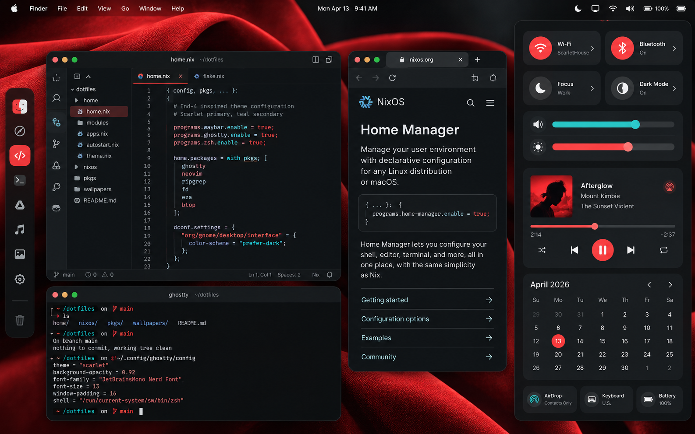
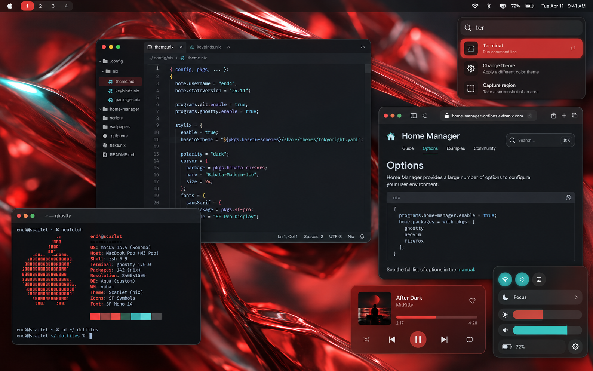

# Scarlet and teal desktop concepts

**Agreed direction:** a modern end-4-inspired desktop with more saturated color, scarlet dominant and teal accents. Nick approved the overall direction after viewing the generated concepts. He rejected the dock and prefers keyboard-driven window navigation.

These are visual concepts generated with the built-in image tool, directed using Impeccable's composition, color, typography and contrast guidance. Visible application content and configuration are illustrative. The pictures do not establish a working macOS implementation or configuration syntax.

## Accepted visual requirements

1. Keep the modern, rounded character of the end-4 reference.
2. Make scarlet the dominant chromatic color, with smaller teal accents.
3. Keep code and text legible on calm dark working surfaces; exact hex values remain adjustable.
4. Omit a persistent app dock, bottom control shelf and app-launching rail. The left app rail in the Sidebar concept is excluded from the accepted direction.
5. Prioritize keyboard navigation. A slim workspace/status bar and summoned control panels are proposed interpretations, subject to actual macOS capability and the later interaction decision.

## Sidebar concept

Useful reference: grouped controls, rounded surfaces, scarlet wallpaper and active states. Its left app rail is rejected. The tall control panel is a showcase state, not a requirement to leave it open while working.

## Floating concept

Useful reference: wallpaper exposure, separate control popups and compact workspace indicators. Nick has not selected floating window behavior or this exact composition.

## Remaining interaction decision

Keyboard-driven navigation and manual drop-zone placement are agreed. Nick prefers PowerToys/FancyZones-style halves, thirds, quarters and custom regions, currently uses Raycast, and explicitly dislikes automatic tiling. He prefers dragging into zones over placement shortcuts. Windows should remain where placed until a deliberate action moves them. Workspace behavior, exact activation controls and final tools remain open. See [manual window arrangement](manual-window-arrangement.md) for the researched candidates.

The Dock concept was rejected and is not included as a candidate. No software or system settings were installed or activated.

## Existing theme investigation

Nick is considering an existing theme to reduce maintenance, while retaining the original saturated scarlet/cyan appearance. He rejected Catppuccin and Gruvbox as too subdued and declined a comparison viewer. [Cyberdream research and regenerated concepts](cyberdream.md) show the closest existing palette and a version with one scarlet accent override. This is a recommendation awaiting Nick's reaction; it does not replace the accepted visual direction yet.

## Provenance

Generated using the built-in image-generation tool. The inspected end-4 widgets screenshot served as a visual reference: https://github.com/user-attachments/assets/6a32395f-9437-4192-8faf-2951a9e84cbe . Prompts are preserved in [prompts.json](prompts.json).

Moom is Nick's provisional preference for manual drop-zone placement. Next: validate its saved-layout drop zones during the later setup trial.
