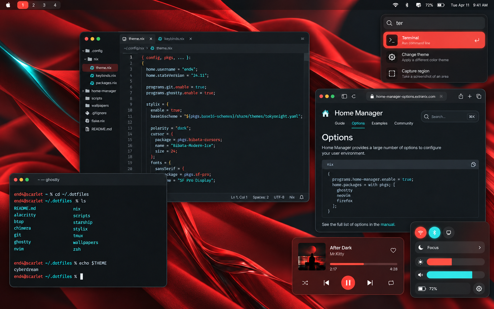
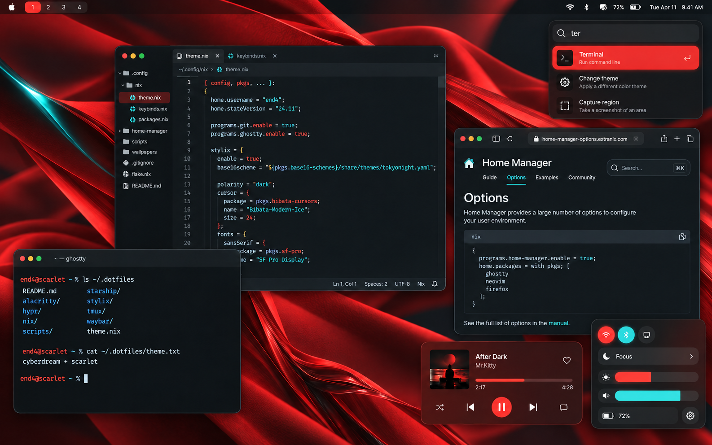

# Cyberdream as the existing theme foundation

**Recommendation:** Cyberdream's default dark palette, with an optional single red accent override to retain the approved scarlet. Nick liked the original scarlet/cyan direction, rejected Catppuccin and Gruvbox as too subdued, and requested research plus regenerated screenshots. No theme foundation has been selected on Nick's behalf.

The [primary-source research](https://github.com/NickSeagull/dotfiles/blob/research/scarlet-cyan-themes/docs/research/scarlet-cyan-themes.md) compares Cyberdream, Doom One and Cyberpunk Scarlet Protocol. Cyberdream is closest in palette: neutral charcoal, warm red and bright cyan. This judgment is based on source values, not a promise that a theme supplies an entire macOS shell.

## Existing Cyberdream palette

Source colors: base `#16181A`, elevated surface `#1E2124`, foreground `#FFFFFF`, warm red `#FF6E5E`, cyan `#5EF1FF`. The screenshot illustrates those colors in the already chosen modern rounded desktop composition, with scarlet wallpaper and red given the main accent role. Cyberdream itself is a multicolor syntax/terminal theme; this red-forward desktop treatment is a proposed adaptation.

## Cyberdream with scarlet accent

Keep the same upstream background, foreground, cyan and other colors; replace the primary red with `#FF493D`. This is explicitly customized Cyberdream, not the unchanged upstream palette. It is the recommended compromise between the original aesthetic and an existing theme foundation.

The renders approximate palette values. They preserve the composition rather than establish pixel-exact app themes, implementation syntax, or live system state. The depicted editor, browser and control surfaces are concept treatments. Moom drop zones, keyboard switching and no app dock remain the agreed interaction constraints.

## What can be reused

Cyberdream provides official Ghostty, tmux, OpenCode and other exports, as well as Nix extras outputs. A published usable VS Code Cyberdream extension was not verified. The browser, bar, wallpaper, and desktop popups would still need coordinated styling; exact integration work remains to be decided. [Upstream palette](https://github.com/scottmckendry/cyberdream.nvim/blob/main/lua/cyberdream/colors.lua), [official extras](https://github.com/scottmckendry/cyberdream.nvim/blob/main/README.md).

## Provenance

Both previews were generated with the built-in image tool, using Impeccable color/composition guidance and the [original custom concept](assets/custom-scarlet-teal.png) as the edit reference. The exact prompts are saved in [cyberdream-prompts.json](cyberdream-prompts.json). No comparison viewer was created; Nick explicitly declined one. No software was installed or activated.

Next: react to the existing palette or scarlet accent version before settling the theme foundation.
